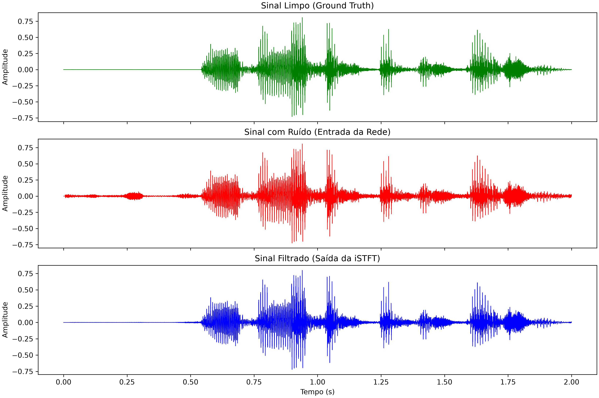
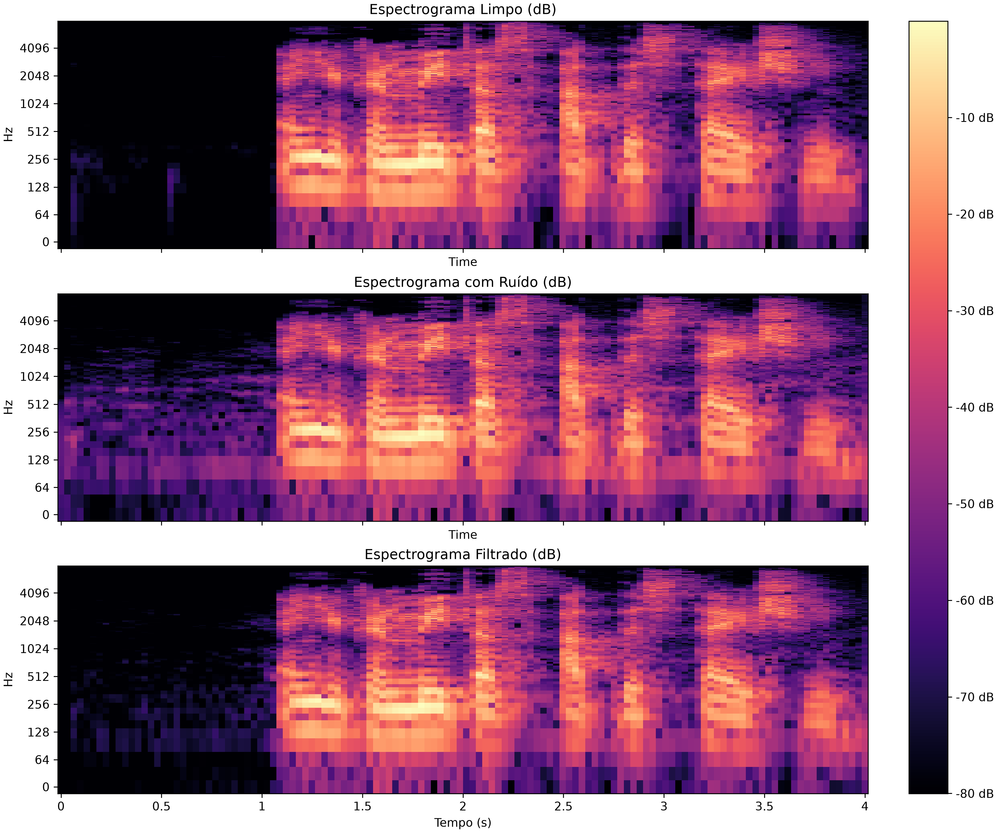

# Noise Suppressor

Sistema de supressão de ruído não-estacionário usando Redes Neurais Convolucionais (U-Net) e Processamento Digital de Sinais (PDS), focado em viabilidade para futura implantação em **Edge Computing / TinyML**.

## A Ideia

Filtros adaptativos clássicos (como LMS e Wiener) falham ao lidar com ruídos abruptos e não-estacionários devido ao seu tempo de convergência. Para contornar isso, este projeto adota um paradigma de visão computacional para o áudio: 

1. O sinal de voz é convertido em um **Espectrograma** (uma matriz 2D) via STFT.
2. Uma rede neural **TinyU-Net** atua como um filtro espacial inteligente, analisando as texturas do espectrograma para prever uma **Máscara de Proporção Ideal (IRM)**.
3. A máscara é multiplicada pelo espectrograma ruidoso, zerando as frequências do ruído e mantendo a voz.
4. O sinal é reconstruído via iSTFT.

Como a rede prevê apenas a máscara de magnitude (valores entre 0 e 1), a topologia se mantém leve e otimizada para restrições severas de memória e processamento em microcontroladores.

## Resultados da Prova de Conceito

Abaixo, a validação visual do fluxo de supressão aplicando a máscara sobre o espectrograma ruidoso e reconstruindo um sinal desconhecido pelo treinamento.

### Domínio do Tempo
Comparação entre o sinal original limpo, o sinal corrompido por ruído e o sinal reconstruído após a filtragem espacial pela rede.



### Domínio da Frequência
Comparação das matrizes de magnitude em escala de Decibéis (dB). Nota-se a atenuação do ruído de fundo (áreas escuras) no espectrograma filtrado, preservando a estrutura harmônica da voz.



## Arquitetura do Projeto

```text
noise_supressor/
├── data/
│   ├── clean/               # Amostras de voz limpa (Mozilla Common Voice)
│   ├── noise/               # Amostras de ruído ambiental
│   ├── precomputed/         # Tensores .pt (noisy_mag, IRM) prontos para treino
│   ├── test/                # Amostras de áudio para validação
│   └── imgs/                # Gráficos gerados pela PoC
├── src/
│   ├── dsp_utils.py         # Funções de PDS (STFT, iSTFT, IRM, Plots)
│   ├── model.py             # Arquitetura minimalista da TinyU-Net
│   ├── dataset_builder.py   # Carregamento, mixagem de áudio e geração de tensores
│   ├── preprocess_dataset.py# Script para pré-calcular e salvar o dataset em .pt
│   ├── train.py             # Loop de treinamento PyTorch
│   └── main.py              # Ponto de entrada: orquestra o pipeline de inferência
├── checkpoints/             # Pesos treinados (.pth)
└── requirements.txt
```
